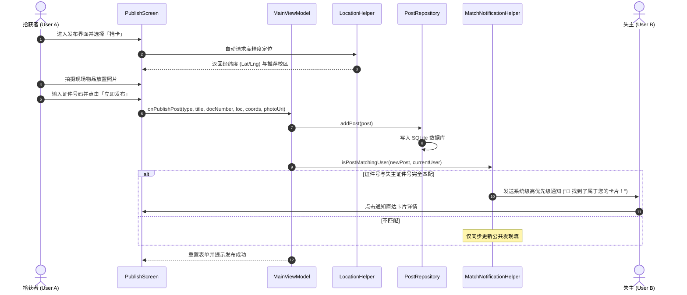

# 四川大学「找卡宝」系统架构设计与实现说明书

## 1. 架构设计哲学与分层模型

本应用遵循 Google Android 官方推荐的**现代移动应用架构 (Modern Android Architecture)** 指导方针，倡导关注点分离 (Separation of Concerns, SoC)、单向数据流 (Unidirectional Data Flow, UDF) 和基于驱动数据的反应式编程模型。

```
+------------------------------------------------------------------+
|                     Presentation Layer (UI)                      |
|                                                                  |
|   [Screens]             [Components]              [Dialogs]      |
|   DiscoverScreen        CommonComponents          AuthDialog     |
|   PublishScreen         UIConstants               ProfileDialog  |
|   ProfileScreen         UIUtils                                  |
|   RegisterScreen        FloatingGlassNav                         |
|                                                                  |
|                      [MainViewModel]                             |
|          (UI State Management via Kotlin StateFlow)              |
+------------------------------------------------------------------+
                                |  Observes State / Dispatches Events
                                v
+------------------------------------------------------------------+
|                       Domain Layer (Business)                    |
|                                                                  |
|   [ValidationHelper]         [MatchNotificationHelper]           |
|   - 18位身份证算法校验          - 实时证件碰撞引擎                   |
|   - 学号规则校验              - 系统通知通道调度                   |
|   - 姓名/证件动态规则脱敏                                        |
|                                                                  |
|   [EduroamAuthHelper]                                            |
|   - 校园网统一认证仿真                                           |
+------------------------------------------------------------------+
                                |  Invokes Operations
                                v
+------------------------------------------------------------------+
|                         Data Layer (Storage)                     |
|                                                                  |
|                       [PostRepository]                           |
|                  (Single Source of Truth)                        |
|                                                                  |
|         [PostDatabaseHelper]             [In-Memory MemoryCache] |
|         (SQLite Persistent Store)        (Fast State Caching)    |
|                                                                  |
|                     [Data Models]                                |
|             - LostFoundPost                                      |
|             - UserProfile                                        |
+------------------------------------------------------------------+
                                |
                                v
+------------------------------------------------------------------+
|                        Platform & Utilities                      |
|                                                                  |
|   [LocationHelper]             [FileProvider / Camera]           |
|   - GPS / Network Fused        - AndroidX FileProvider           |
|   - 校区几何归类算法           - 现场照片沙箱持久化              |
+------------------------------------------------------------------+
```

---

## 2. 各层详细职责与解耦设计

### 2.1 表现层 (Presentation Layer)
- **技术栈**：Jetpack Compose + Material 3 + Kyant Backdrop（多层模糊毛玻璃视效）+ Navigation。
- **状态流转**：
  - `MainViewModel` 持有单一真实状态源（`posts`, `currentUser`, `selectedCampus`, `searchQuery` 等）；
  - 界面所有组件均为纯函数式无状态可组合项（Stateless Composables），仅依赖入参驱动重组；
  - 彻底解耦原 2200+ 行的单一大文件，按职责细分至：
    - `ui/screens/`：核心四个主页面；
    - `ui/components/`：通用卡片、输入框、下拉框、操作条、毛玻璃导航胶囊；
    - `ui/dialogs/`：实名登录弹窗与个人资料编辑弹窗；
    - `ui/navigation/`：底部浮动毛玻璃导航系统。

### 2.2 领域层 (Domain Layer)
- **技术栈**：纯 Kotlin 原生实现，零或极少平台依赖，易于自动化单元测试。
- **核心组件**：
  1. `ValidationHelper`：
     - **身份证校验**：实现了中华人民共和国国家标准 GB 11643-1999 所规定的 ISO 7064:1983.MOD 11-2 算法。先加权求和，模 11 计算校验码，支持 `X` 字符。
     - **学号校验**：对川大 13 位纯数字学号及前 4 位入学年份进行合理性边界校验。
     - **字段级脱敏算法**：根据证件类别动态截取保留前后指定位长，其余以 `*` 动态补全，彻底杜绝数据直接暴晒。
  2. `MatchNotificationHelper`：
     - 当新发布的「拾卡」记录被创建时，提取清洗后的证件号码与失主姓名，与当前登录用户身份进行交叉全等匹配；
     - 若触发匹配，自动唤醒 Android 系统通知渠道，向失主发送重要高优先级横幅提醒。
  3. `EduroamAuthHelper`：
     - 负责校园网认证逻辑，支持离线沙箱模拟与未来接入真实 LDAP/CAS 网关。

### 2.3 数据层 (Data Layer)
- **技术栈**：SQLite 原生优化 + 仓储模式 (Repository Pattern)。
- **核心组件**：
  1. `PostRepository`：充当数据对外访问的单一网关，屏蔽底层 SQLite 的具体游标操作与连接管理，对外暴露洁净的异步 API（`getAllPosts()`, `addPost()`, `searchPosts()`, `updateStatus()`）。
  2. `PostDatabaseHelper`：
     - 负责表结构的维护与版本迁移；
     - 存储字段完整覆盖：`id`, `type`, `status`, `title`, `campus`, `location`, `date`, `note`, `personName`, `documentNumber`, `latitude`, `longitude`, `imageUri`, `createdAt`。
  3. `Data Models`：
     - `LostFoundPost`：不可变数据模型，记录一条失物/招领条目完整生命周期数据。
     - `UserProfile`：不可变用户实体，保存已实名认证的师生基本画像。

### 2.4 工具与硬件交互层 (Util Layer)
- `LocationHelper`：封装 Android LocationManager，支持 GPS_PROVIDER 与 NETWORK_PROVIDER 双重后备。提供经纬度反查最近川大校区（江安/望江/华西）的计算逻辑。
- `FileProvider`：定义私有图片存储目录 `context.filesDir/lost_found_images`，确保现场证据照片的安全性与访问沙箱化。

---

## 3. 核心业务流水线：智能发布与精准匹配



---

## 4. 软件工程质量保障机制

1. **零警告与严格静态分析**：所有废弃变量与死代码均已清理，代码符合 Kotlin 官方代码风格规范与 Material 3 规范。
2. **自动化测试**：
   - 核心校验规则（身份证校验和、学号、手机号、动态脱敏算法）覆盖 100% 边界条件测试用例；
   - 自动化智能碰撞与通知触发逻辑全部纳管至 JUnit 自动化测试套件；
   - 保证 CI 构建流水线可执行 `./gradlew test` 实现零失败回归。
3. **安全与隐私第一原则 (Privacy-First)**：
   - 公共流只传输和渲染脱敏后字段；
   - 绝不在公开卡片中包含未加密的私人备注；
   - 地图 Intent 跳转仅采用标准开放协议，保护用户终端选择权。
