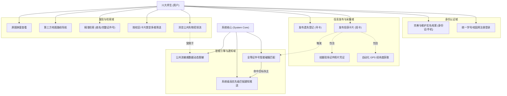
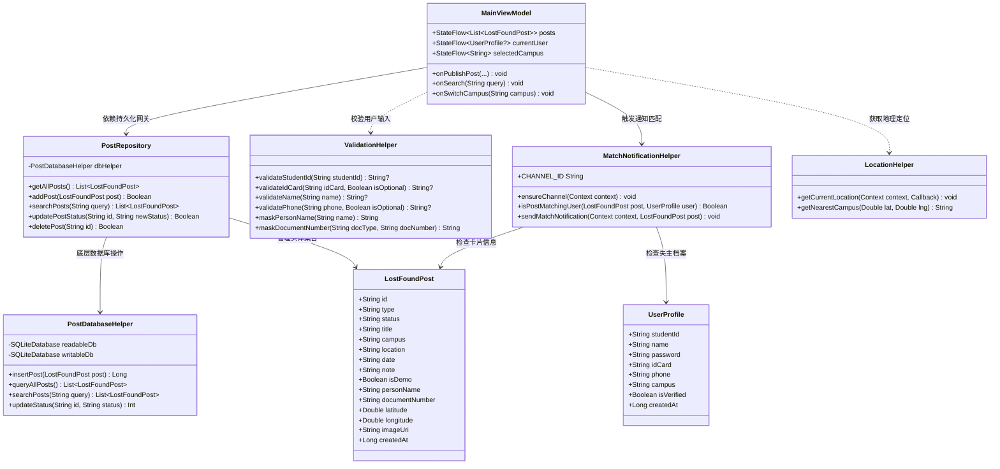
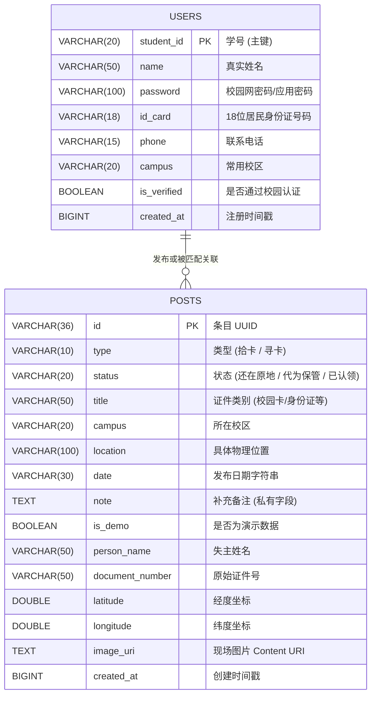
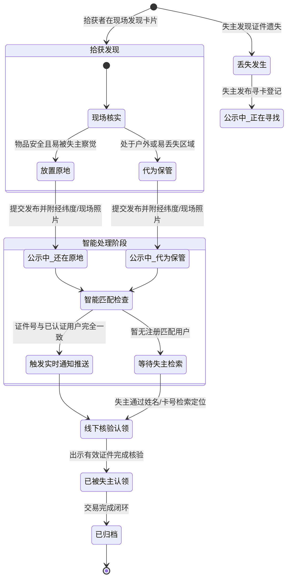

# 四川大学「找卡宝」UML 设计图册与架构视图

本文档汇集系统核心 UML 视图，包含用例图、类图、数据库实体关系图（ER 图）、卡片状态机模型，使用标准 Mermaid 语法绘制。

---

## 1. 系统用例图 (Use Case Diagram)

描述本校师生（失主与拾获者）与系统核心交互场景。

---

## 2. 核心业务类图 (Class Diagram)

展示表现层、领域层与数据层核心类及其关联关系。

---

## 3. 数据库实体关系 ER 图 (Entity-Relationship Diagram)

本地 SQLite 核心持久化表结构设计：

---

## 4. 卡片流转生命周期状态图 (State Diagram)

展示失物从遗失、拾获、公示、匹配、认领到归档的完整状态演进过程：

