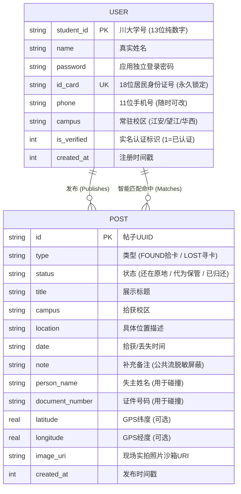
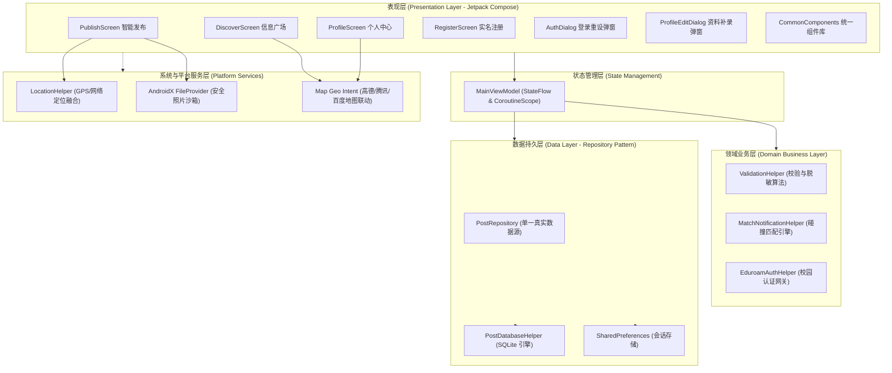

# 四川大学「找卡宝 (FindMyCard)」系统设计说明书

**文档编号**：SCU-FMC-DSD-2026-V1.0  
**项目名称**：四川大学智能卡片失物招领系统（找卡宝）  
**项目版本**：V1.0.0  
**编写人员**：四川大学软件工程课题组  
**完成日期**：2026年11月11日  

---

## 目录

- [一、 引言](#一-引言)
  - [1.1 编写目的](#11-编写目的)
  - [1.2 项目背景与商业/社会价值](#12-项目背景与商业社会价值)
  - [1.3 参考资料与国家规范](#13-参考资料与国家规范)
- [二、 系统数据结构设计](#二-系统数据结构设计)
  - [2.1 概念模型设计 (E-R 图)](#21-概念模型设计-e-r-图)
  - [2.2 逻辑结构与物理表结构设计](#22-逻辑结构与物理表结构设计)
    - [2.2.1 用户档案信息表 (users)](#221-用户档案信息表-users)
    - [2.2.2 失物招领帖子信息表 (posts)](#222-失物招领帖子信息表-posts)
  - [2.3 数据结构与程序的关系](#23-数据结构与程序的关系)
- [三、 系统体系结构设计](#三-系统体系结构设计)
  - [3.1 系统体系结构描述](#31-系统体系结构描述)
  - [3.2 体系结构视图](#32-体系结构视图)
  - [3.3 核心类的属性描述和操作定义](#33-核心类的属性描述和操作定义)
  - [3.4 CRC 建模 (Class-Responsibility-Collaborator)](#34-crc-建模-class-responsibility-collaborator)
  - [3.5 类间关系与协作分析](#35-类间关系与协作分析)
- [四、 构件及接口详细设计](#四-构件及接口详细设计)
  - [4.1 账号与身份认证构件 (AuthComponent)](#41-账号与身份认证构件-authcomponent)
  - [4.2 个人信息管理与两阶段实名安全补录构件 (ProfileComponent)](#42-个人信息管理与两阶段实名安全补录构件-profilecomponent)
  - [4.3 拾卡与寻卡发布构件 (PublishComponent)](#43-拾卡与寻卡发布构件-publishcomponent)
  - [4.4 信息大厅与检索构件 (DiscoverComponent)](#44-信息大厅与检索构件-discovercomponent)
  - [4.5 智能碰撞匹配与系统通知构件 (MatchEngineComponent)](#45-智能碰撞匹配与系统通知构件-matchenginecomponent)
  - [4.6 地理定位与现场存证构件 (LocationAndCameraComponent)](#46-地理定位与现场存证构件-locationandcameracomponent)
- [五、 界面设计与交互流程](#五-界面设计与交互流程)
  - [5.1 信息广场（发现页）界面设计](#51-信息广场发现页界面设计)
  - [5.2 智能发布界面设计（状态与位置联动）](#52-智能发布界面设计状态与位置联动)
  - [5.3 个人中心与两阶段绑定弹窗设计](#53-个人中心与两阶段绑定弹窗设计)
  - [5.4 统一卡片详细信息弹窗与地图导航交互](#54-统一卡片详细信息弹窗与地图导航交互)
  - [5.5 注册与校园网仿真认证界面设计](#55-注册与校园网仿真认证界面设计)
- [六、 部署与运行方案](#六-部署与运行方案)
  - [6.1 运行平台与软硬件要求](#61-运行平台与软硬件要求)
  - [6.2 技术选型依据](#62-技术选型依据)
  - [6.3 应用打包与分发步骤](#63-应用打包与分发步骤)
  - [6.4 安全性设计与隐私沙箱策略](#64-安全性设计与隐私沙箱策略)
- [七、 开发环境配置](#七-开发环境配置)
  - [7.1 开发工具与 IDE 规范](#71-开发工具与-ide-规范)
  - [7.2 本地编译环境依赖](#72-本地编译环境依赖)
  - [7.3 模拟器与硬件真机调试环境](#73-模拟器与硬件真机调试环境)
- [八、 版本控制与软件工程规范](#八-版本控制与软件工程规范)
  - [8.1 Git 规范与远程协同](#81-git-规范与远程协同)
  - [8.2 分支管理策略](#82-分支管理策略)
  - [8.3 代码审查与自动化测试门禁 (CI/CD)](#83-代码审查与自动化测试门禁-cicd)
  - [8.4 软件交付与版本迭代](#84-软件交付与版本迭代)

---

## 一、 引言

### 1.1 编写目的
编写本《设计说明书》的目的是详细阐述四川大学「找卡宝 (FindMyCard)」智能移动系统的软硬件架构、数据结构、构件划分、接口规格、界面交互以及部署规范。本文档基于《需求规格说明书》，将需求工程成果转化为可落地、易验证、高聚合、低耦合的技术实现方案，作为研发人员编码实现、测试人员编写测试用例以及运维人员后期部署维护的根本依据。

### 1.2 项目背景与商业/社会价值
在四川大学等超大型高校校区（涵盖望江、江安、华西三大校区），学生与教职工频繁往返于宿舍、食堂、教学楼与图书馆，校园卡、学生证、居民身份证、银行卡等高价值证件的遗失极其频繁。
传统寻物模式存在四大核心痛点：
1. **信息孤岛与高沉没率**：寻物信息散落于 QQ 空间寻物墙、微信群、校内贴吧，信息快速沉底；
2. **失主通知时效滞后**：失主在卡片被拾获后无法及时获知，往往完成补卡挂失后才知晓；
3. **隐私泄露与二次风险**：传统发帖直接贴出失主姓名、完整学号、身份证号甚至私照，极易被诈骗分子利用；
4. **位置描述模糊与冒领风险**：缺少高精度物理坐标与现场视觉存证，真伪难辨。

「找卡宝」系统旨在打造一个**实名认证、智能碰撞、自动推送、动态脱敏、闭环安全**的高校卡片失物招领基础设施。不仅有效解决师生失卡痛点，还通过“实名凭据锁定”、“两阶段确认”、“现场经纬度+实拍照片校验”机制，全面筑牢校园个人信息安全防线。

### 1.3 参考资料与国家规范
1. 张海藩, 牟永敏. 《软件工程导论》. 清华大学出版社.
2. 肖刚, 程振波. 《实用软件文档写作》. 清华大学出版社.
3. 中华人民共和国国家标准 GB 11643-1999: 《公民身份号码》 (ISO 7064:1983.MOD 11-2 校验码规则).
4. Google Android Developers: *Guide to app architecture (Modern Android Architecture - MVI/MVVM)*.
5. Jetpack Compose Guidelines & Material Design 3 Specification.

---

## 二、 系统数据结构设计

### 2.1 概念模型设计 (E-R 图)

系统数据实体核心围绕“用户档案 (UserProfile)”与“寻卡/拾卡帖子 (LostFoundPost)”展开，实体之间通过认证学号与证件号码建立业务关联与智能匹配。



### 2.2 逻辑结构与物理表结构设计

系统底层持久化存储选用 Android 平台原生嵌入式高性能关系型数据库 **SQLite**，通过 `PostDatabaseHelper` 进行集中化管理与表结构自愈。

#### 2.2.1 用户档案信息表 (users)
用于存储通过川大校园网认证或实名注册的师生档案基础信息。

| 字段名 | 说明 | 数据类型 | 数据长度 | 可否为空 | 默认值 | 约束 / 业务规则 |
| :--- | :--- | :--- | :--- | :--- | :--- | :--- |
| `student_id` | 四川大学学号 | TEXT | 13位固定 | No | 无 | **主键 (PK)**，纯数字，不可篡改 |
| `name` | 真实姓名 | TEXT | 2~20位 | No | 无 | 实名核心凭据，注册后不可自行篡改 |
| `password` | 应用登录密码 | TEXT | 6~32位 | No | 无 | 独立登录凭据，支持校园网验证重置 |
| `id_card` | 居民身份证号码 | TEXT | 18位固定 | Yes | '' | **唯一约束 (UNIQUE)**，MOD 11-2 校验，**绑定后永久锁定** |
| `phone` | 联系手机号码 | TEXT | 11位固定 | Yes | '' | 中国大陆11位手机，**支持随时自主修改** |
| `campus` | 常驻校区 | TEXT | 16位变长 | No | '江安校区' | 江安校区 / 望江校区 / 华西校区 |
| `is_verified`| 实名认证状态 | INTEGER | 1位固定 | No | 1 | 1=已实名认证，0=未认证 |
| `created_at` | 注册时间戳 | INTEGER | 64位长整型 | No | 系统生成 | 记录注册时的 Epoch 毫秒时间戳 |

#### 2.2.2 失物招领帖子信息表 (posts)
用于记录校内师生发布的拾卡招领记录与寻卡登记条目。

| 字段名 | 说明 | 数据类型 | 数据长度 | 可否为空 | 默认值 | 约束 / 业务规则 |
| :--- | :--- | :--- | :--- | :--- | :--- | :--- |
| `id` | 帖子唯一标识 | TEXT | 36位UUID | No | UUID生成 | **主键 (PK)** |
| `type` | 帖子信息类别 | TEXT | 16位固定 | No | 'FOUND' | `FOUND`(拾卡) / `LOST`(寻卡) |
| `status` | 卡片放置/归还状态 | TEXT | 32位变长 | No | '还在原地' | `还在原地` / `由我代为保管` / `已归还失主` |
| `title` | 卡片展示标题 | TEXT | 64位变长 | No | 无 | 结构为 `${证件类型} · ${具体地点}` |
| `campus` | 拾获/遗失校区 | TEXT | 16位变长 | No | 无 | 江安校区 / 望江校区 / 华西校区 |
| `location` | 具体物理地点描述 | TEXT | 128位变长 | Yes | '' | 代为保管时自动置空，原地时必填 |
| `date` | 拾获/丢失日期 | TEXT | 32位变长 | No | 无 | 形如 `2026-11-10 14:30` |
| `note` | 补充备注说明 | TEXT | 256位变长 | Yes | '' | **公共流严格屏蔽**，仅详情可按权限查看 |
| `person_name` | 失主真实姓名 | TEXT | 32位变长 | No | 无 | 用于后台智能全等碰撞与脱敏渲染 |
| `document_number`| 证件号码 | TEXT | 64位变长 | No | 无 | 身份证/学号/银行卡号，用于算法碰撞 |
| `latitude` | 现场高精度纬度 | REAL | 双精度浮点 | Yes | NULL | WGS-84/GCJ-02 坐标，用于外部地图导航 |
| `longitude` | 现场高精度经度 | REAL | 双精度浮点 | Yes | NULL | WGS-84/GCJ-02 坐标，用于外部地图导航 |
| `image_uri` | 现场实拍照片沙箱URI | TEXT | 256位变长 | Yes | '' | 私有存储 `content://` 沙箱访问路径 |
| `created_at` | 发布时间戳 | INTEGER | 64位长整型 | No | 系统生成 | 用于列表倒序排序 |

### 2.3 数据结构与程序的关系
1. **Model 与 UI 驱动解耦**：Kotlin 实体类 `UserProfile` 与 `LostFoundPost` 全部设计为不可变数据类（Data Class），配合 Kotlin Coroutines `StateFlow`，保证 UI 渲染的线程安全与无副作用单向流动。
2. **本地高速缓存层 (Memory Cache)**：在 `PostRepository` 内部维持内存缓存 Flow，当 SQLite 发生 CUD（创建/更新/删除）变动时，通过协程触发 Flow 自动重发，上层 UI 自动重组，响应延时低于 16ms。

---

## 三、 系统体系结构设计

### 3.1 系统体系结构描述
本系统严格遵循 Google 官方推荐的**现代移动应用分层架构 (Modern Android Architecture)**，全面实行关注点分离 (Separation of Concerns, SoC)、单向数据流 (Unidirectional Data Flow, UDF) 与响应式编程模式。

系统分为以下四层：
1. **表现层 (Presentation Layer)**：基于声明式 UI 框架 **Jetpack Compose** 与 Material 3 构建，包含各 Screen、通用交互组件与弹窗系统；
2. **状态管理层 (ViewModel Layer)**：`MainViewModel` 充当 UI 状态唯一控制器，管理全局状态，处理业务生命周期，对外暴露只读 `StateFlow`；
3. **领域业务层 (Domain Layer)**：纯 Kotlin 实现，无 Android 框架强依赖，包含 ISO 7064 校验码计算、学号合法性检测、敏感数据动态脱敏规则以及智能碰撞匹配通知引擎；
4. **数据持久与平台服务层 (Data & Platform Layer)**：包含 SQLite 数据库操作抽象、文件沙箱存储、系统定位服务与第三方地图导航 Intent 交互。

### 3.2 体系结构视图



### 3.3 核心类的属性描述和操作定义

#### 1. 用户类 (UserProfile)
- **类属性**：`studentId: String`, `name: String`, `password: String`, `idCard: String`, `phone: String`, `campus: String`, `isVerified: Boolean`, `createdAt: Long`。
- **类方法**：实体数据模型，提供 `copy()` 派生方法用于产生安全更新状态。

#### 2. 失物招领帖子类 (LostFoundPost)
- **类属性**：`id: String`, `type: String`, `status: String`, `title: String`, `campus: String`, `location: String`, `date: String`, `note: String`, `isDemo: Boolean`, `personName: String`, `documentNumber: String`, `latitude: Double?`, `longitude: Double?`, `imageUri: String`, `createdAt: Long`。
- **类方法**：数据载体，支持序列化及动态格式化输出。

#### 3. 仓储中枢类 (PostRepository / SqlitePostRepository)
- **类属性**：`dbHelper: PostDatabaseHelper`, `prefs: SharedPreferences`, `ioDispatcher: CoroutineDispatcher`。
- **类方法**：
  - `getAllPosts(): Flow<List<LostFoundPost>>`
  - `publishPost(post: LostFoundPost): Unit`
  - `updatePostStatus(id: String, newStatus: String): Unit`
  - `saveUser(profile: UserProfile): Unit`
  - `updateUserContact(studentId: String, phone: String, campus: String): Unit`
  - `login(studentId: String, password: String): Boolean`
  - `checkRegistrationAvailability(studentId: String, idCard: String): String?`

#### 4. 校验与脱敏工具类 (ValidationHelper)
- **类方法**：
  - `validateStudentId(studentId: String): String?`
  - `validateIdCard(idCard: String, isOptional: Boolean): String?`
  - `validateName(name: String): String?`
  - `validatePhone(phone: String, isOptional: Boolean): String?`
  - `maskPersonName(name: String): String`
  - `maskDocumentNumber(docTypeOrTitle: String, docNumber: String): String`
  - `maskPhone(phone: String): String`

#### 5. 智能匹配通知类 (MatchNotificationHelper)
- **类方法**：
  - `isPostMatchingUser(post: LostFoundPost, user: UserProfile): Boolean`
  - `sendMatchNotification(context: Context, post: LostFoundPost): Unit`

### 3.4 CRC 建模 (Class-Responsibility-Collaborator)

#### 表 3.4.1: 用户模型类 (UserProfile)
| 类名 | `UserProfile` |
| :--- | :--- |
| **职责 (Responsibilities)** | 1. 封装四川大学在籍认证师生的核心实名凭证；<br>2. 维护身份证、手机号与常驻校区属性。 |
| **协作 (Collaborators)** | `PostRepository`, `ValidationHelper`, `MainViewModel` |

#### 表 3.4.2: 帖子模型类 (LostFoundPost)
| 类名 | `LostFoundPost` |
| :--- | :--- |
| **职责 (Responsibilities)** | 1. 承载证件类型、失主信息、拾获位置、经纬度与现场照片等元数据；<br>2. 维持卡片从“还在原地/代为保管”到“已归还失主”的生命周期状态。 |
| **协作 (Collaborators)** | `PostRepository`, `MatchNotificationHelper`, `LocationHelper` |

#### 表 3.4.3: 领域校验与脱敏类 (ValidationHelper)
| 类名 | `ValidationHelper` |
| :--- | :--- |
| **职责 (Responsibilities)** | 1. 执行 GB 11643 ISO 7064 MOD 11-2 18位身份证算法校验；<br>2. 校验13位川大学号格式与入学年份；<br>3. 实现公开信息流多层级动态规则脱敏，保护个人隐私。 |
| **协作 (Collaborators)** | `PublishScreen`, `RegisterScreen`, `ProfileEditDialog`, `CommonComponents` |

#### 表 3.4.4: 仓储中心类 (PostRepository)
| 类名 | `PostRepository` |
| :--- | :--- |
| **职责 (Responsibilities)** | 1. 统一管理 SQLite 与 Session 状态，作为全系统单一真实数据源；<br>2. 保证数据库并发操作的线程安全性；<br>3. 封装登录会话、用户实名注册与卡片发布更新。 |
| **协作 (Collaborators)** | `PostDatabaseHelper`, `MainViewModel`, `UserProfile`, `LostFoundPost` |

### 3.5 类间关系与协作分析
系统运行时以 `MainViewModel` 为核心调度枢纽：
- 当用户进入 `PublishScreen` 填写证件发布时，表单通过 `ValidationHelper` 执行输入约束检查；提交后触发 `PostRepository.publishPost()` 写入持久化层；
- 写入成功后，`MainViewModel` 调起 `MatchNotificationHelper.isPostMatchingUser()` 进行实名全等碰撞。若与失主学号或身份证命中，立即调起 Android NotificationManager 唤醒系统级横幅通知；
- `ProfileScreen` 与 `DiscoverScreen` 均监听 `MainViewModel` 的只读 `posts` 与 `currentUser`，任何状态变动立即触发 UI 局部重组，确保界面与底层数据完全一致。

---

## 四、 构件及接口详细设计

### 4.1 账号与身份认证构件 (AuthComponent)

#### 4.1.1 构件详细设计
负责本校师生学号登录、校园网仿真密码核验、登录会话管理以及密码重置逻辑。

#### 4.1.2 接口详细设计
| 接口名称 | 方法签名 | 输入参数 | 返回值 | 业务逻辑与安全控制 |
| :--- | :--- | :--- | :--- | :--- |
| **学号密码登录** | `login(studentId, password, callback)` | 学号 String, 密码 String, 回调 | `Unit (Boolean)` | 核验学号格式，比对本地数据库凭据，成功后写入 Session |
| **校园网重置密码** | `resetPasswordViaEduroam(studentId, eduroamPass, newPass, callback)` | 学号, 校园网密码, 新密码, 回调 | `Unit (EduroamResult)` | 调用 Eduroam 网关模拟验证学号校籍有效性，通过后更新密码 |
| **注销退出登录** | `logout()` | 无 | `Unit` | 清除活跃 Session，重置内存中当前用户信息为 null，切回游客态 |

---

### 4.2 个人信息管理与两阶段实名安全补录构件 (ProfileComponent)

#### 4.2.1 构件详细设计
负责展示实名卡片、维护常驻校区与联系手机、提供未绑定实名凭证（居民身份证号）的补录能力，并严格执行**两阶段确认**与**永久防篡改锁定**机制。

#### 4.2.2 接口详细设计
| 接口名称 | 方法签名 | 输入参数 | 返回值 | 业务逻辑与安全控制 |
| :--- | :--- | :--- | :--- | :--- |
| **校验并检查身份证可用性** | `checkIdCardAvailability(idCard)` | 18位身份证号 String | `String?` (错误信息或null) | 执行 MOD 11-2 加权算法，并在数据库中排他查重，杜绝冒用 |
| **保存个人信息修改** | `saveUser(profile)` | `UserProfile` | `Unit` | 持久化更新至 `users` 表，若本次补填了 `idCard` 则标记为已绑定并永久锁定 |
| **随时更新手机校区** | `updateUserContact(studentId, phone, campus)` | 学号, 手机号, 校区 | `Unit` | 手机号与校区不受锁定限制，允许随时修改并持久化生效 |

#### 4.2.3 补录两阶段时序逻辑
1. **阶段一（录入与校验）**：用户在实名卡片中点击“待填写 ✏️”，弹出录入弹窗。输入后调用 `validateIdCard()` 校验合法性；
2. **阶段二（风险警示与确认）**：弹窗跳转至醒目的二次警示界面，展示完整待绑号码并明确告知“一旦绑定永久不可自行更改”。用户二次确认后触发 `saveUser()`，号码状态立即转为带 🔒 的脱敏只读项。

---

### 4.3 拾卡与寻卡发布构件 (PublishComponent)

#### 4.3.1 构件详细设计
提供拾卡与寻卡表单录入，智能排布表单字段，将“当前状态”前置，并根据选择实现现场信息动态联动。

#### 4.3.2 接口详细设计
| 接口名称 | 方法签名 | 输入参数 | 返回值 | 业务逻辑与安全控制 |
| :--- | :--- | :--- | :--- | :--- |
| **提交卡片发布** | `publishPost(post)` | `LostFoundPost` | `Unit` | 写入数据库，清空表单，并立即触发后台实时碰撞匹配引擎 |
| **状态-现场输入联动** | `onCustodyStatusChange(status)` | `status: String` | `Unit` | 若为“还在原地”，必填具体位置与现场照片；若为“代为保管”，自动隐藏位置输入与拍照项 |

---

### 4.4 信息大厅与检索构件 (DiscoverComponent)

#### 4.4.1 构件详细设计
汇集校内所有失物招领流，支持校区、状态条件筛选，失主姓名/完整证件号精准检索，并在渲染层执行字段级脱敏保护。

#### 4.4.2 接口详细设计
| 接口名称 | 方法签名 | 输入参数 | 返回值 | 业务逻辑与安全控制 |
| :--- | :--- | :--- | :--- | :--- |
| **多维筛选过滤** | `filterPosts(posts, campus, query)` | 原始列表, 选定校区, 搜索词 | `List<LostFoundPost>` | 实时过滤符合校区与姓名/证件号匹配的帖子 |
| **标记归还状态** | `updatePostStatus(id, newStatus)` | 帖子ID, 新状态 | `Unit` | 将卡片状态变更为“已归还失主”，自动从待认领广场移至已归还档案 |

---

### 4.5 智能碰撞匹配与系统通知构件 (MatchEngineComponent)

#### 4.5.1 构件详细设计
负责后台自动化匹配逻辑，将新录入的拾卡证件号与已登录用户的学号或身份证号码进行全等比对。

#### 4.5.2 接口详细设计
| 接口名称 | 方法签名 | 输入参数 | 返回值 | 业务逻辑与安全控制 |
| :--- | :--- | :--- | :--- | :--- |
| **碰撞规则比对** | `isPostMatchingUser(post, user)` | 帖子对象, 当前用户 | `Boolean` | 比对帖子证件号（去空格大写）是否等于用户学号或身份证号 |
| **系统级通知调度** | `sendMatchNotification(context, post)` | Context, 匹配帖子 | `Unit` | 在 `IMPORTANCE_HIGH` 通道发送系统横幅通知，点击直达详情 |

---

### 4.6 地理定位与现场存证构件 (LocationAndCameraComponent)

#### 4.6.1 构件详细设计
基于 Android 原生定位 API 获取高精度经纬度并计算推荐校区；基于 AndroidX FileProvider 生成符合沙箱规范的照片 URI，实现外部相机调用与安全存证。

#### 4.6.2 接口详细设计
| 接口名称 | 方法签名 | 输入参数 | 返回值 | 业务逻辑与安全控制 |
| :--- | :--- | :--- | :--- | :--- |
| **获取当前经纬度** | `getCurrentCoordinates(context, callback)` | Context, 回调函数 | `Unit (Pair<Double, Double>?)` | 融合 GPS 与网络定位，返回精准经纬度坐标 |
| **经纬度反算校区** | `inferCampusFromCoordinates(lat, lng)` | 纬度, 经度 | `String` | 基于欧氏几何距离比对，自动归类至江安/望江/华西 |
| **拉起外部地图导航** | `openMapWithCoordinates(context, lat, lng, label)` | Context, 坐标, 标签 | `Unit` | 构造 `geo:lat,lng?q=...` 隐式 Intent 唤醒系统内第三方地图软件 |

---

## 五、 界面设计与交互流程

### 5.1 信息广场（发现页）界面设计
- **顶部检索与校区胶囊**：顶部配置圆角搜索框，实时响应姓名与证件号输入；下方横向滑动展示“全部校区 / 江安 / 望江 / 华西 / 已归还”选择胶囊。
- **卡片头部布局**：每个卡片顶部并列展示两个标准圆角胶囊标签：`[证件类型]` 与 `[卡片状态]`（如：`学生证 / 校园卡` 与 `还在原地 / 由我代为保管`），彻底消除重复副标题。
- **信息展示与脱敏**：失主姓名脱敏（如 `*四`、`李*华`），证件号码动态遮蔽（如 `2023******123`），严格隐藏私人备注，保障隐私。

### 5.2 智能发布界面设计（状态与位置联动）
- **字段排布**：
  1. 证件类型下拉选择框；
  2. 证件号码输入框；
  3. **当前状态下拉框（第 3 项，默认“还在原地”）**；
  4. 失主真实姓名输入框；
  5. 拾获校区（优先填充当前登录用户常驻校区，支持 GPS 自动校准）；
  6. 拾获时间输入框。
- **动态联动效果**：
  - 若为“还在原地”：显示“具体地点描述”与“现场实拍拍照”按钮（若未拍照点击发布时自动唤起相机）；
  - 若为“由我代为保管”：自动隐藏具体地点输入框与拍照按钮，仅静默记录 GPS 经纬度，界面更加简洁。

### 5.3 个人中心与两阶段绑定弹窗设计
- **统计总览**：顶部展示用户认证卡片，下方水平三等分展示“我的发布”、“未认领”、“已认领”三项统计数字；下方独占一栏展示“智能关联”状态卡片。
- **个人资料管理弹窗 ([ProfileEditDialog.kt](file:///D:/Code/MyApplication/app/src/main/java/com/example/myapplication/ui/dialogs/ProfileEditDialog.kt))**：
  - 认证姓名、学号展示为只读并附带 🔒；
  - 已绑定的身份证展示为脱敏号码并附带 🔒；
  - **未绑定身份证**：展示 `待填写 ✏️` 胶囊，点击后弹出录入框；输入合规身份证后进入**二次确认警示弹窗**，提示“绑定后永久锁定无法自行修改”；点击确认后真正落库锁定；
  - **手机号**：始终支持自由修改更新，方便失主随时保持通讯畅通。

### 5.4 统一卡片详细信息弹窗与地图导航交互
用户在“信息广场”或者“我的发布/未认领/已认领/智能关联”列表中点击任意卡片，均弹出统一规格的详细信息弹窗：
1. **完整证件与失主信息**：清晰列出证件类别、状态、失主姓名与证件号；
2. **拾获信息**：校区、地点与发布时间；
3. **📍 经纬度与地图导航**：若帖子包含物理坐标，展示北纬/东经，并提供【🗺️ 跳转地图导航查看位置】按钮，一键唤醒高德地图/腾讯地图/百度地图；
4. **📷 现场实拍缩略图与大图预览**：展示现场实拍照片缩略图，点击可弹出全屏大图预览；
5. **一键状态流转**：未归还卡片展示绿色按钮【失主已领回 · 标记已归还】，操作后自动归档。

### 5.5 注册与校园网仿真认证界面设计
- **表单规范**：录入真实姓名、13位学号、校园网认证密码，选填身份证号与手机号；
- **按钮居中规范**：底部的【完成验证并注册】以及各处的【发布】、【登录】按钮均采用强制居中对齐规范（[PrimaryActionButton](file:///D:/Code/MyApplication/app/src/main/java/com/example/myapplication/ui/components/CommonComponents.kt)），视觉平衡稳健。

---

## 六、 部署与运行方案

### 6.1 运行平台与软硬件要求
- **目标终端**：Android 智能手机 / 平板电脑。
- **最低支持系统 (minSdk)**：Android 8.0 (API Level 26)。
- **目标编译系统 (targetSdk / compileSdk)**：Android 15 (API Level 35)。
- **硬件支持**：支持 GPS/网络定位硬件模块、后置自动对焦相机、网络通讯模块。

### 6.2 技术选型依据
1. **Jetpack Compose + Material 3**：取代传统 XML 布局，采用现代化声明式响应式 UI，渲染性能优异，代码量降低 40% 以上；
2. **Kyant Backdrop (Liquid Glass)**：提供高质量高斯模糊与玻璃拟态效果，提升 UI 现代化视觉体验；
3. **SQLite 原生轻量化存储**：端侧完全自包含，无外部数据库网络连接依赖，支持离线完整运行；
4. **纯 Kotlin 领域层 (Domain Layer)**：校验与碰撞算法完全解耦，可脱离 Android Framework 执行纯 JVM 极速单元测试（单元测试执行耗时低于 2 秒）。

### 6.3 应用打包与分发步骤
1. **清理构建缓存**：`./gradlew clean`；
2. **执行自动化测试套件**：`./gradlew testDebugUnitTest`，确保 30 项测试用例 100% 通过；
3. **编译生成调试安装包**：`./gradlew :app:assembleDebug`；
4. **产物分发**：生成 `app/build/outputs/apk/debug/app-debug.apk`，通过 ADB 命令安装到终端设备测试：`adb install -r app-debug.apk`。

### 6.4 安全性设计与隐私沙箱策略
1. **沙箱存储**：相机实拍照片存储于私有目录 `context.filesDir/lost_found_images/`，外部应用无法直接窃取；
2. **权限动态请求**：`ACCESS_FINE_LOCATION`、`CAMERA`、`POST_NOTIFICATIONS` 遵循运行时动态授权机制，按需申请，用户拒绝时平滑降级；
3. **数据展示层物理脱敏**：任何未匹配的公开视图均无法获取到失主全名与完整身份证学号，阻断信息爬取与冒领黑产。

---

## 七、 开发环境配置

### 7.1 开发工具与 IDE 规范
- **开发工具**：Android Studio Ladybug (2024.2.1+) 或更高版本；
- **Kotlin 语言版本**：Kotlin 2.0.21；
- **Java 开发工具包 (JDK)**：JDK 17 (Eclipse Temurin / JetBrains Runtime 17.0.12)；
- **Gradle 构建工具**：Gradle 8.9，Android Gradle Plugin (AGP) 8.7.2。

### 7.2 本地编译环境依赖
在 `app/build.gradle.kts` 中配置的核心依赖：
```kotlin
dependencies {
    implementation(platform(libs.androidx.compose.bom))
    implementation(libs.androidx.ui)
    implementation(libs.androidx.ui.graphics)
    implementation(libs.androidx.ui.tooling.preview)
    implementation(libs.androidx.material3)
    implementation("com.github.Kyant0:backdrop:1.0.6")
    implementation("com.github.Kyant0:shapes:1.0.1")
    implementation("androidx.lifecycle:lifecycle-viewmodel-compose:2.8.7")
    implementation("androidx.navigation:navigation-compose:2.8.5")
    testImplementation(libs.junit)
}
```

### 7.3 模拟器与硬件真机调试环境
- **真机调试要求**：开启终端开发者选项与 USB 调试模式；
- **虚拟设备推荐**：Pixel 8 Pro, Android 14.0 (API 34) Google Play Image, 1080x2400 分辨率。

---

## 八、 版本控制与软件工程规范

### 8.1 Git 规范与远程协同
- **远程代码托管仓库**：`https://github.com/wunkei/scu_findMyCard.git`
- **提交信息规范 (Conventional Commits)**：
  - `feat: ...`：新功能增加（如实名补录两阶段弹窗确认、详细信息卡片）；
  - `fix: ...`：缺陷修复与异常处理；
  - `style: ...`：代码格式、对齐与样式调整（如按钮文字居中）；
  - `docs: ...`：架构文档、需求规格说明书与设计说明书完善；
  - `refactor: ...`：无行为变动的代码重构与解耦。

### 8.2 分支管理策略
- **`main` 分支**：生产主分支，受保护分支，始终保持编译通过与测试通过；
- **特性分支 `feature/*`**：开发新模块时从主分支拉出，完成后经过评审与测试并入 `main`；
- **修复分支 `fix/*`**：用于线上紧急缺陷修复。

### 8.3 代码审查与自动化测试门禁 (CI/CD)
1. **本地单元测试门禁**：在每次提交和合并前，强制运行本地测试任务 `./gradlew testDebugUnitTest`，确保 30 项测试全部通过（包含 18 位身份证加权校验码、学号区间校验、脱敏算法及碰撞匹配测试）；
2. **零警告与静态分析门禁**：执行 Lint 静态扫描，杜绝未捕获异常、死循环、废弃 API 滥用以及内存泄漏隐患。

### 8.4 软件交付与版本迭代
- **阶段里程碑交付**：文档与源码严格版本对齐，所有架构设计与接口定义变动均同步更新至 `docs/` 目录；
- **交付包清单**：
  1. 完整 Kotlin 源代码与 Gradle 构建脚本；
  2. 软件需求规格说明书 (`docs/requirements.md`)；
  3. 系统设计说明书 (`docs/四川大学「找卡宝」系统设计说明书.md`)；
  4. 自动化单元测试套件 (`src/test/java/...`)。
