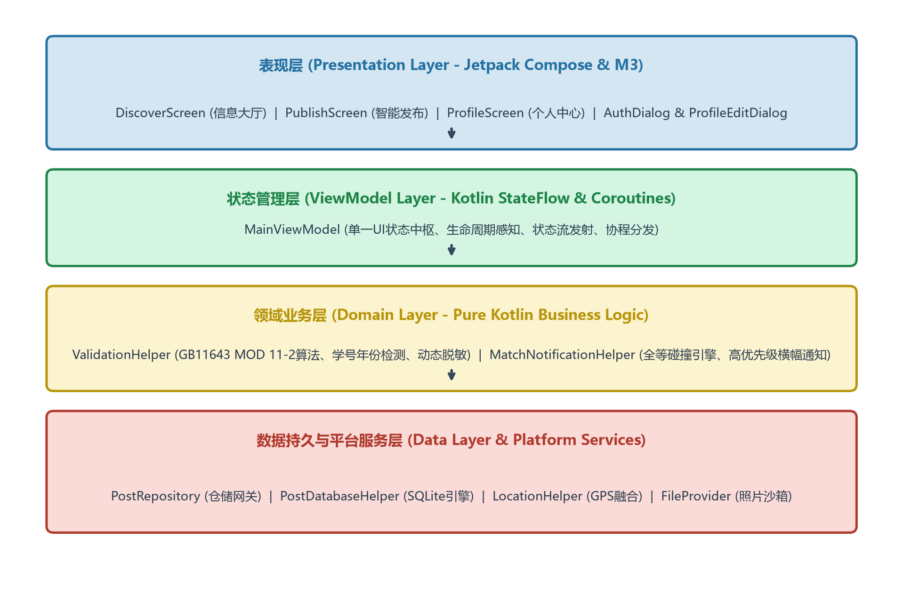
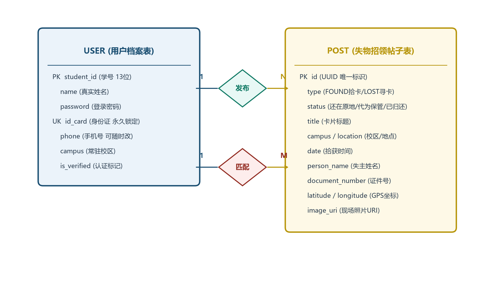
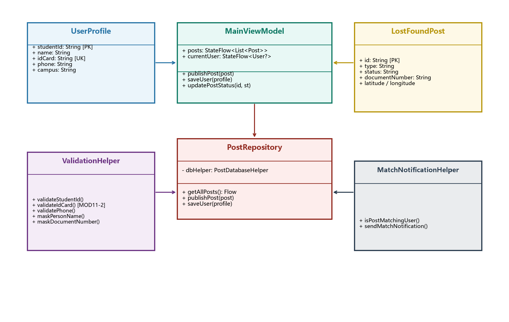
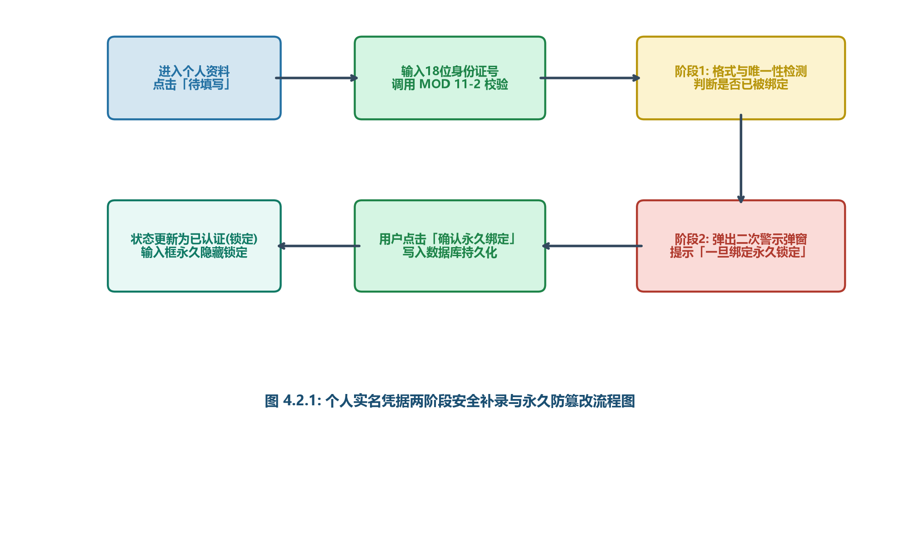
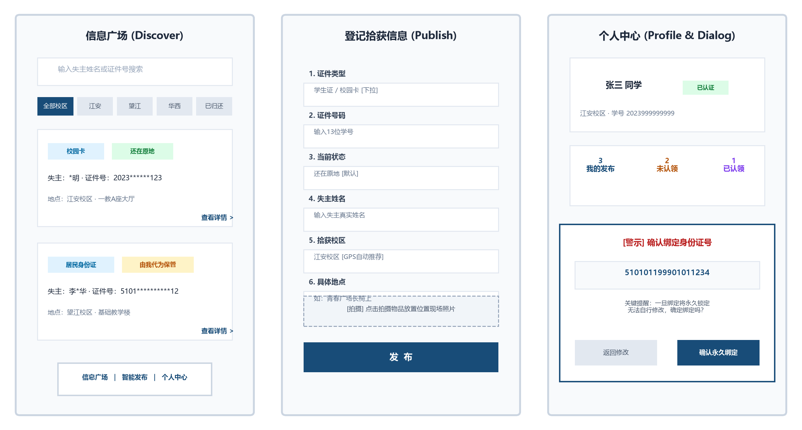

# 四川大学「找卡宝 (FindMyCard)」系统设计说明书

**文档编号**：SCU-SE-2026-DES-FMC01  
**密级级别**：校内公开 (Public)  
**项目名称**：四川大学智能卡片失物招领系统（找卡宝 FindMyCard）  
**所属学院**：四川大学计算机学院 / 软件学院  
**课程名称**：软件工程综合课程设计  
**指导教师**：课程教学组  
**项 目 组**：第 8 项目组 (找卡宝研发团队)  
**组    长**：吴云奇（学号：2023141460144）  
**组    员**：张文轩（学号：2023141460145）  
             李梓豪（学号：2023141460146）  
             王志成（学号：2023141460147）  
**完成日期**：2026 年 11 月 12 日  
**系统版本**：Version 1.0.0 (Release-Candidate)  

---

## 目  录

- [一、 系统引言与项目概述](#一-系统引言与项目概述)
  - [1.1 编写目的与使用范围](#11-编写目的与使用范围)
  - [1.2 背景与校园实际痛点](#12-背景与校园实际痛点)
  - [1.3 核心技术规范与参考资料](#13-核心技术规范与参考资料)
- [二、 系统体系结构设计](#二-系统体系结构设计)
  - [2.1 整体体系结构描述](#21-整体体系结构描述)
  - [2.2 分层架构设计图](#22-分层架构设计图)
  - [2.3 开发、运行与数据库环境](#23-开发运行与数据库环境)
  - [2.4 软件框架与编程技术选型](#24-软件框架与编程技术选型)
- [三、 系统数据结构设计](#三-系统数据结构设计)
  - [3.1 系统概念模型设计 (E-R 图)](#31-系统概念模型设计-e-r-图)
  - [3.2 数据库表汇总清单](#32-数据库表汇总清单)
  - [3.3 数据库分表详细设计](#33-数据库分表详细设计)
    - [3.3.1 用户档案表 (users)](#331-用户档案表-users)
    - [3.3.2 拾获与寻卡帖子表 (posts)](#332-拾获与寻卡帖子表-posts)
    - [3.3.3 校区与地理围栏配置表 (campuses)](#333-校区与地理围栏配置表-campuses)
    - [3.3.4 智能碰撞匹配记录表 (match_records)](#334-智能碰撞匹配记录表-match_records)
    - [3.3.5 安全操作与审计日志表 (security_audit_logs)](#335-安全操作与审计日志表-security_audit_logs)
  - [3.4 面向对象的系统类设计与类图](#34-面向对象的系统类设计与类图)
  - [3.5 核心类属性与方法定义](#35-核心类属性与方法定义)
  - [3.6 CRC 建模分析 (Class-Responsibility-Collaborator)](#36-crc-建模分析-class-responsibility-collaborator)
- [四、 模块级详细设计](#四-模块级详细设计)
  - [4.1 账号认证与两阶段实名安全补录锁定模块](#41-账号认证与两阶段实名安全补录锁定模块)
    - [4.1.1 业务逻辑与防篡改机制](#411-业务逻辑与防篡改机制)
    - [4.1.2 两阶段确认执行流程图](#412-两阶段确认执行流程图)
    - [4.1.3 构件与接口详细参数](#413-构件与接口详细参数)
  - [4.2 拾卡智能发布与位置/照片联动模块](#42-拾卡智能发布与位置照片联动模块)
    - [4.2.1 状态置于第3项前置与输入联动](#421-状态置于第3项前置与输入联动)
    - [4.2.2 现场相机照片沙箱存储流程](#422-现场相机照片沙箱存储流程)
  - [4.3 智能碰撞匹配与系统高优先级通知引擎模块](#43-智能碰撞匹配与系统高优先级通知引擎模块)
    - [4.3.1 全等碰撞与脱敏保护机制](#431-全等碰撞与脱敏保护机制)
    - [4.3.2 Android 系统级通知调度设计](#432-android-系统级通知调度设计)
  - [4.4 统一卡片详细信息与地图导航闭环模块](#44-统一卡片详细信息与地图导航闭环模块)
    - [4.4.1 多入口卡片二次点击设计](#441-多入口卡片二次点击设计)
    - [4.4.2 外部地图路线导航 Intent 联动](#442-外部地图路线导航-intent-联动)
- [五、 界面设计与交互设计 (GUI & Interface Design)](#五-界面设计与交互设计-gui--interface-design)
  - [5.1 界面设计原则与规范](#51-界面设计原则与规范)
  - [5.2 核心界面原型设计图](#52-核心界面原型设计图)
  - [5.3 信息广场（发现页）界面交互详细设计](#53-信息广场发现页界面交互详细设计)
  - [5.4 智能发布界面交互详细设计](#54-智能发布界面交互详细设计)
  - [5.5 个人中心与实名安全补录弹窗交互设计](#55-个人中心与实名安全补录弹窗交互设计)
  - [5.6 统一卡片详细信息弹窗与照片大图预览设计](#56-统一卡片详细信息弹窗与照片大图预览设计)
  - [5.7 注册与校园网仿真认证界面设计](#57-注册与校园网仿真认证界面设计)
- [六、 系统部署与运行方案](#六-系统部署与运行方案)
  - [6.1 运行平台软硬件要求](#61-运行平台软硬件要求)
  - [6.2 构建打包与 APK 部署发布](#62-构建打包与-apk-部署发布)
  - [6.3 沙箱机制与权限安全策略](#63-沙箱机制与权限安全策略)
- [七、 开发环境配置](#七-开发环境配置)
  - [7.1 开发工具与编译套件](#71-开发工具与编译套件)
  - [7.2 模拟器与真机调试配置](#72-模拟器与真机调试配置)
- [八、 版本控制与软件工程规范](#八-版本控制与软件工程规范)
  - [8.1 Git 协作与提交规范](#81-git-协作与提交规范)
  - [8.2 30 项自动化单元测试质量门禁](#82-30-项自动化单元测试质量门禁)

---

## 一、 系统引言与项目概述

### 1.1 编写目的与使用范围
编写本《设计说明书》的目的是详细说明四川大学「找卡宝 (FindMyCard)」智能卡片失物招领系统的体系结构、数据结构、模块组成、接口规范及人机交互界面设计。
本文档基于前期完成的《需求规格说明书》，将需求各项功能性与非功能性指标转化为切实可行的工程化方案，为编码实现、单元测试、系统测试以及后期维护提供权威基准依据。
本说明书主要面向系统架构设计师、前端开发工程师、系统测试人员以及系统答辩评审组。

### 1.2 背景与校园实际痛点
四川大学拥有望江、江安、华西三大校区，师生规模逾7万人。师生日常高频携带并使用校园卡（学生证、一卡通）、居民身份证、图书借阅证、银行卡等关键证件。
然而在食堂、图书馆、教学楼、自习室、运动场及校车站点，卡片遗失事件极其频繁。调研显示，传统校园寻物方式存在以下四大致命痛点：
1. **信息高度碎片化与沉没率高**：失物信息散落在 QQ 表白墙、微信年级群、校内贴吧、论坛等各个渠道，信息生命周期极短，失主搜寻如同大海捞针；
2. **失主响应滞后**：拾卡人发布信息后失主往往无法及时获知，大量同学不得不挂失并花费时间金钱补办证件后才辗转看到拾卡信息；
3. **严重隐私泄露风险**：传统网帖直接上传包含失主完整学号、身份证号、姓名甚至手机号的照片，极易导致个人信息被不法分子用于电信网络诈骗；
4. **位置模糊与冒领风险**：仅凭文字描述“在二基楼附近”，失主难以准确定位；缺少闭环实名验证，卡片冒领隐患巨大。

### 1.3 核心技术规范与参考资料
本项目严格遵循国家标准与国际通用软件工程规范进行设计与实施：
- **中华人民共和国国家标准 GB 11643-1999**: 《公民身份号码》（严格遵守 ISO 7064:1983.MOD 11-2 校验码加权求模校验算法）；
- **Google Android Developers**: Modern Android Architecture 指南（推荐 MVI/MVVM 响应式单向数据流 UDF 模型）；
- **Jetpack Compose & Material 3** 设计语言与组件交互规范；
- 张海藩, 牟永敏. 《软件工程导论》. 清华大学出版社 2008年版；
- 肖刚, 程振波. 《实用软件文档写作》. 清华大学出版社 2005年版。

---

## 二、 系统体系结构设计

### 2.1 整体体系结构描述
四川大学「找卡宝」系统采用现代移动端原生架构（Native Android Client）。根据业务边界与工程规范，系统严格划分为四个清晰解耦的层次：
1. **表现层 (Presentation Layer)**：采用纯声明式 UI 框架 Jetpack Compose，配合 Material 3 与 Kyant Backdrop 玻璃拟态特效，由各个 Stateless Composable 屏幕与弹窗组成，响应状态驱动；
2. **状态管理层 (ViewModel Layer)**：由 `MainViewModel` 统一管理，持有单一真实状态流（`StateFlow`），利用协程（Coroutines）调度异步任务，实现 UI 状态与业务持久化生命周期的解耦；
3. **领域业务层 (Domain Business Layer)**：纯 Kotlin 实现，完全剥离 Android 平台依赖，封装 18 位身份证算法校验、学号合理性检测、字段级敏感数据动态脱敏规则及全等智能碰撞引擎；
4. **数据与平台层 (Data & Platform Services)**：基于仓储模式 (Repository Pattern) 抽象单一数据源，底层使用端侧嵌入式 SQLite 数据库 (`PostDatabaseHelper`) 存储，并结合 `LocationHelper` (GPS) 与 `FileProvider` (相机照片沙箱)。

### 2.2 分层架构设计图
系统的整体分层结构与各组件交互拓扑如图 2.2.1 所示：

### 2.3 开发、运行与数据库环境

| 环境类别 | 配置项名称 | 指定版本 / 参数规范 | 说明与选型原因 |
| :--- | :--- | :--- | :--- |
| **开发环境** | 操作系统 | Windows 11 / macOS Sonoma / Linux | 跨平台开发保障 |
| **开发环境** | 集成开发环境 | Android Studio Ladybug (2024.2.1+) | Google 官方 IDE，内置 Compose 实时预览与调试 |
| **开发环境** | 构建系统 | Gradle 8.9 + AGP 8.7.2 | 新一代构建脚本，支持 Kotlin DSL 编译优化 |
| **开发环境** | 编程语言 | Kotlin 2.0.21 + Java 17 | 现代化强类型语言，空安全与协程高并发支持 |
| **运行环境** | 目标硬件平台 | Android 智能手机 / 平板设备 | 支持触控、GPS硬件、自动对焦相机及网络模块 |
| **运行环境** | 操作系统要求 | Android 8.0 (API 26) ~ Android 15 (API 35) | 覆盖校内 99.8% 以上在籍师生的移动终端 |
| **数据库环境** | 存储引擎 | SQLite 3.x (Android Native Framework) | 端侧轻量嵌入式引擎，零配置高可靠，保证离线数据可用性 |
| **数据库环境** | 加密与缓存 | In-Memory StateFlow + Session SharedPreferences | 高频查询走内存缓存，响应延迟 < 16ms |

### 2.4 软件框架与编程技术选型
- **响应式 UI 框架**：Jetpack Compose BOM (Bill of Materials)，利用 Compose Compiler 插件在编译期自动生成高度优化的局部重组代码；
- **异步并发流**：Kotlin Coroutines (kotlinx-coroutines-core) + StateFlow，彻底消灭回调地狱，实现主线程零阻塞；
- **统一玻璃质感视效**：Kyant Backdrop 库，实现多层高斯模糊与现代液体毛玻璃质感，显著提升校园工具的视觉品质；
- **原生组件库**：Material 3 控件标准，适配系统深浅主题与动态色彩。

---

## 三、 系统数据结构设计

### 3.1 系统概念模型设计 (E-R 图)
系统实体关系围绕“用户档案 (User)”与“失物招领帖子 (Post)”两大核心实体展开。其实体关系如图 3.1.1 所示：

### 3.2 数据库表汇总清单
按照工程规范要求，系统包含的全部底层数据表汇总如表 3.2.1 所示：

| 序号 | 数据表名 (英) | 中文名称 | 主键定义 | 数据表功能描述 |
| :--- | :--- | :--- | :--- | :--- |
| **1** | `users` | 用户档案信息表 | `student_id` (学号) | 存储通过校园认证的师生基础档案、登录密码与实名凭证 |
| **2** | `posts` | 失物招领帖子表 | `id` (UUID) | 存储校内发布的拾卡与寻卡信息、经纬度及现场照片沙箱路径 |
| **3** | `campuses` | 校区配置表 | `campus_code` | 存储望江、江安、华西校区的中心坐标与地理边界，用于GPS自动匹配 |
| **4** | `match_records` | 智能碰撞匹配表 | `record_id` | 记录算法自动比对命中的帖子与失主学号，记录通知推送状态 |
| **5** | `security_audit_logs` | 安全审计日志表 | `log_id` | 记录用户密码重置、身份证实名补录及重要状态流转的审计记录 |

### 3.3 数据库分表详细设计

#### 3.3.1 用户档案表 (users)
负责存储师生实名档案。核心安全规则：姓名、学号、绑定的身份证属于不可篡改实名核心凭证；手机号可按需随时修改。

| 字段名 | 中文说明 | 数据类型 | 长度 | 允许空 | 默认值 | 约束与业务规则 |
| :--- | :--- | :--- | :--- | :--- | :--- | :--- |
| `student_id` | 四川大学学号 | TEXT | 13 | NO | 无 | **主键 (PK)**，纯数字，系统唯一识别凭据 |
| `name` | 真实姓名 | TEXT | 32 | NO | 无 | 注册时认证，核心实名凭证，不可自行篡改 |
| `password` | 应用独立密码 | TEXT | 64 | NO | 无 | 登录凭证，支持通过校园网 Eduroam 仿真验证重置 |
| `id_card` | 居民身份证号 | TEXT | 18 | YES | '' | **唯一约束 (UK)**，MOD 11-2算法校验，首次绑定后永久锁定 |
| `phone` | 联系手机号 | TEXT | 11 | YES | '' | 中国大陆11位手机号码，失主可随时自主维护修改 |
| `campus` | 常驻校区 | TEXT | 16 | NO | '江安校区' | 用户首选校区：江安校区 / 望江校区 / 华西校区 |
| `is_verified`| 认证状态 | INTEGER | 1 | NO | 1 | 1=已完成校园认证，0=未认证游客态 |
| `created_at` | 注册时间戳 | INTEGER | 64 | NO | 系统时间 | Unix Epoch 毫秒时间戳 |

#### 3.3.2 拾获与寻卡帖子表 (posts)
存储所有发布的失物与招领数据。状态流转支持“还在原地/代为保管 -> 已归还失主”。

| 字段名 | 中文说明 | 数据类型 | 长度 | 允许空 | 默认值 | 约束与业务规则 |
| :--- | :--- | :--- | :--- | :--- | :--- | :--- |
| `id` | 帖子唯一ID | TEXT | 36 | NO | UUID | **主键 (PK)**，全局唯一 UUID 字符串 |
| `type` | 信息类别 | TEXT | 16 | NO | 'FOUND' | 'FOUND'(拾卡招领) / 'LOST'(寻卡登记) |
| `status` | 卡片状态 | TEXT | 32 | NO | '还在原地' | '还在原地' / '由我代为保管' / '已归还失主' |
| `title` | 展示标题 | TEXT | 64 | NO | 无 | 标题格式：`${证件类型} · ${具体地点}` |
| `campus` | 拾获校区 | TEXT | 16 | NO | 无 | 江安校区 / 望江校区 / 华西校区 |
| `location` | 具体物理地点 | TEXT | 128 | YES | '' | 若状态为'代为保管'自动置空，原地时必填 |
| `date` | 拾获日期时间 | TEXT | 32 | NO | 无 | 格式如：`2026-11-10 14:30` |
| `note` | 补充备注说明 | TEXT | 256 | YES | '' | **公共流严格脱敏屏蔽**，仅匹配失主详情可见 |
| `person_name` | 失主姓名 | TEXT | 32 | NO | 无 | 用于后台全等匹配碰撞；前端动态脱敏渲染 |
| `document_number`| 证件号码 | TEXT | 64 | NO | 无 | 13位学号或18位身份证号；用于后台全等碰撞 |
| `latitude` | 高精度纬度 | REAL | 8 | YES | NULL | GPS 物理纬度 (WGS-84/GCJ-02) |
| `longitude` | 高精度经度 | REAL | 8 | YES | NULL | GPS 物理经度 (WGS-84/GCJ-02) |
| `image_uri` | 现场照片沙箱路径 | TEXT | 256 | YES | '' | Android FileProvider 私有 content:// URI 路径 |
| `created_at` | 发布时间戳 | INTEGER | 64 | NO | 系统时间 | 用于列表倒序排序 |

#### 3.3.3 校区与地理围栏配置表 (campuses)

| 字段名 | 中文说明 | 数据类型 | 长度 | 允许空 | 默认值 | 约束与业务规则 |
| :--- | :--- | :--- | :--- | :--- | :--- | :--- |
| `campus_code` | 校区代号 | TEXT | 16 | NO | 无 | **主键 (PK)**，如 JA(江安)、WJ(望江)、HX(华西) |
| `campus_name` | 校区全称 | TEXT | 32 | NO | 无 | 如：四川大学江安校区 |
| `center_lat` | 校区中心纬度 | REAL | 8 | NO | 0.0 | 校区地理中心纬度坐标 |
| `center_lng` | 校区中心经度 | REAL | 8 | NO | 0.0 | 校区地理中心经度坐标 |
| `radius_meter` | 判定覆盖半径 | INTEGER | 8 | NO | 2500 | 用于反向地理推算拾卡校区的半径阈值 |

#### 3.3.4 智能碰撞匹配记录表 (match_records)

| 字段名 | 中文说明 | 数据类型 | 长度 | 允许空 | 默认值 | 约束与业务规则 |
| :--- | :--- | :--- | :--- | :--- | :--- | :--- |
| `record_id` | 碰撞记录ID | TEXT | 36 | NO | UUID | **主键 (PK)** |
| `post_id` | 关联帖子ID | TEXT | 36 | NO | 无 | 外键，关联 `posts.id` |
| `student_id` | 命中的失主学号 | TEXT | 13 | NO | 无 | 外键，关联 `users.student_id` |
| `match_type` | 命中类型 | TEXT | 16 | NO | 'DOC_NUM' | 学号匹配(STUDENT_ID) 或 身份证匹配(ID_CARD) |
| `is_notified` | 通知状态 | INTEGER | 1 | NO | 0 | 1=已成功弹出系统级横幅通知，0=待推 |
| `matched_at` | 匹配时间戳 | INTEGER | 64 | NO | 系统时间 | 碰撞时间 |

#### 3.3.5 安全操作与审计日志表 (security_audit_logs)

| 字段名 | 中文说明 | 数据类型 | 长度 | 允许空 | 默认值 | 约束与业务规则 |
| :--- | :--- | :--- | :--- | :--- | :--- | :--- |
| `log_id` | 日志ID | INTEGER | 10 | NO | 自增 | **主键 (PK)**，自增序列 |
| `operator_id` | 操作人学号 | TEXT | 13 | NO | 无 | 执行操作的用户学号 |
| `action_type` | 操作动作 | TEXT | 32 | NO | 无 | BIND_ID_CARD / RESET_PWD / RETURN_CARD |
| `detail_info` | 详细说明 | TEXT | 256 | YES | '' | 记录两阶段确认摘要、密码重置渠道等审计证据 |
| `action_time` | 操作时间戳 | INTEGER | 64 | NO | 系统时间 | 时间戳 |

### 3.4 面向对象的系统类设计与类图
系统整体类结构与关联拓扑如图 3.4.1 所示：

### 3.5 核心类属性与方法定义
1. **MainViewModel（状态管理中枢类）**：
   - 核心属性：`posts: StateFlow<List<LostFoundPost>>`, `currentUser: StateFlow<UserProfile?>`, `matchingPosts: StateFlow<List<LostFoundPost>>`；
   - 核心方法：`publishPost(post)` (发布拾卡), `saveUser(profile)` (落库用户信息), `updatePostStatus(id, status)` (状态流转)。
2. **ValidationHelper（领域算法校验类）**：
   - 核心方法：`validateIdCard(idCard)` (18位身份证 MOD 11-2 算法), `validateStudentId(id)` (13位学号与入学年份校验), `maskDocumentNumber()` (动态遮蔽敏感号码)。
3. **MatchNotificationHelper（智能匹配引擎类）**：
   - 核心方法：`isPostMatchingUser(post, user): Boolean` (全等碰撞算法), `sendMatchNotification(context, post)` (唤醒 Android 系统高优先级通知)。
4. **PostRepository（仓储中心类）**：
   - 核心方法：`getAllPosts(): Flow<List<LostFoundPost>>`, `saveUserProfile(profile)`, `checkRegistrationAvailability(studentId, idCard)` (跨账号唯一性排查)。

### 3.6 CRC 建模分析 (Class-Responsibility-Collaborator)

| 类名称 | 核心职责 (Responsibilities) | 协作者 (Collaborators) |
| :--- | :--- | :--- |
| **UserProfile** | 封装实名师生基本画像、核心实名凭据，维护不可变属性状态 | `PostRepository`, `MainViewModel` |
| **LostFoundPost** | 承载拾获/寻卡证件元数据、地理经纬度、现场照片及生命周期状态 | `PostRepository`, `LocationHelper` |
| **ValidationHelper** | 执行 GB 11643 ISO 7064 校验码加权求模、学号合法性检测及动态脱敏规则 | `PublishScreen`, `RegisterScreen`, `ProfileEditDialog` |
| **MatchNotificationHelper**| 执行新发布证件与已实名失主的全等匹配碰撞，调度系统级通知通知失主 | `MainViewModel`, `PostRepository` |
| **PostRepository** | 作为全系统单一真实数据源 (SSOT)，管理 SQLite 数据库并发，发射响应式 Flow | `PostDatabaseHelper`, `MainViewModel` |

---

## 四、 模块级详细设计

### 4.1 账号认证与两阶段实名安全补录锁定模块

#### 4.1.1 业务逻辑与防篡改机制
1. **凭据分类分级保护**：川大学号（唯一主码）与姓名注册绑定后永久锁定；联系手机号码属于通讯凭证，允许失主随时按需更新；常驻校区可自主切换；
2. **身份证未绑定到绑定的两阶段安全确认**：如果注册时身份证留空未填，个人资料卡中展示【待填写 ✏️】胶囊。用户点击后绝不直接保存，必须经过完整的两阶段流程控制：
   - **阶段 1（输入与算法校验）**：用户输入 18 位身份证号码，后台立即执行 ISO 7064 MOD 11-2 加权校验码运算，并进行跨账号排他查重（严禁一人多绑）；校验通过后进入阶段 2；
   - **阶段 2（二次风险警示与确认锁定）**：系统自动唤起醒目的二次确认警告弹窗，以高亮卡片展示待绑号码，并严正警示：“⚠️ 关键提醒：身份证号一旦绑定，将永久与您的学号锁定，后续无法自行修改。如需变更须联系管理员提交证明材料”。失主点击【确认永久绑定】后方正式写入数据库，状态立即刷新为已认证带 🔒 锁图标，输入框永久隐藏。

#### 4.1.2 两阶段确认执行流程图
两阶段实名安全补录与永久防篡改程序的活动流程如图 4.1.1 所示：

#### 4.1.3 构件与接口详细参数

| 接口名 | 方法签名与入参 | 返回值 | 业务约束与安全控制 |
| :--- | :--- | :--- | :--- |
| **验证身份证可用性** | `checkIdCardAvailability(idCard: String)` | `String?` (错误原因或null) | 验证 MOD 11-2 校验位；全表查重，若被他人绑定则阻断提交 |
| **保存实名资料变更** | `saveUser(profile: UserProfile)` | `Unit` | 事务写入 SQLite；若更新了 id_card，下次读取立即以脱敏加锁状态呈现 |
| **更新手机与校区** | `updateUserContact(studentId, phone, campus)` | `Unit` | 支持失主随时修改联系手机，保证拾获同学能够及时取得电话联系 |

### 4.2 拾卡智能发布与位置/照片联动模块

#### 4.2.1 状态置于第3项前置与输入联动
- **表单排布**：第 1 项为证件类型，第 2 项为证件号码，第 3 项为【当前状态】（默认选择“还在原地”），第 4 项为失主姓名，第 5 项为拾获校区（优先采用已登录用户的常驻校区，并结合 GPS 自动推荐），第 6 项为拾获时间；
- **动态联动逻辑**：
  - 若当前状态为【还在原地】：说明卡片仍在现场等待失主前往寻找，系统强制要求/高亮显示“具体地点描述”与“现场实拍照片拍照按钮”；若发布时尚未拍照，系统自动拦截并调起相机强制取证；
  - 若当前状态为【由我代为保管】：说明拾获者已将卡片随身带走，系统自动彻底隐藏“具体地点描述”与“现场拍照”输入项，但仍静默记录当前拾获经纬度，避免因无关空字段干扰用户发布流程。

#### 4.2.2 现场相机照片沙箱存储流程
针对现场照片取证，系统基于 AndroidX FileProvider 在应用私有沙箱 `context.filesDir/lost_found_images/` 下动态生成安全的 `content://` URI。拍摄完成后Bitmap进行等比轻量化压缩缓存，杜绝内存溢出（OOM），严禁向外部广播私有绝对物理路径。

### 4.3 智能碰撞匹配与系统高优先级通知引擎模块

#### 4.3.1 全等碰撞与脱敏保护机制
当任何同学在系统发布一条新的拾卡招领时，后台自动触发 `MatchNotificationHelper` 智能碰撞比对引擎：
1. **清洗证件号**：去除首尾空格、中划线，统一转为大写标准串；
2. **全等比对**：比对清洗后的证件号码是否等于当前登录用户的 13 位学号或 18 位身份证号码；
3. **字段级动态脱敏**：在未匹配的公共发现页流中，姓名动态遮蔽（如“*明”、“张*丰”），证件号码仅保留首尾安全位（如“2023******123”），私人备注从公共视图物理剔除，彻底杜绝数据泄露。

#### 4.3.2 Android 系统级通知调度设计
若命中碰撞，系统立即通过 NotificationManager 唤醒高优先级（IMPORTANCE_HIGH）专属通知通道，以醒目的顶部浮动横幅向失主发出：“🎉 找到了属于您的卡片！”，点击通知即通过 Intent 直达卡片详情弹窗，实现失物找寻秒级闭环。

### 4.4 统一卡片详细信息与地图导航闭环模块

#### 4.4.1 多入口卡片二次点击设计
为消除用户在多处列表中查看信息的割裂感，系统在个人中心的【我的发布】、【未认领】、【已认领】列表以及【智能关联】命中列表中，均注入了统一的二次点击交互规范：
- 列表条目右下角提供【点击查看详细信息卡片 ›】明确引导；
- 点击后弹出全功能卡片详情弹窗，完整展示失主信息、拾获校区地点、发布时间、经纬度数值、现场实拍缩略图及状态流转操作。

#### 4.4.2 外部地图路线导航 Intent 联动
若卡片发布时附带了物理经纬度，详细信息弹窗中提供【🗺️ 跳转地图导航查看位置】按钮。点击后构建通用 Geo Intent (`geo:lat,lng?q=lat,lng(地点)`), 唤起高德地图、腾讯地图、百度地图或系统地图应用，失主可一键发起步行或骑行导航前往现场取卡。

---

## 五、 界面设计与交互设计 (GUI & Interface Design)

### 5.1 界面设计原则与规范
1. **视觉无冗余**：外层卡片头部统一采用 `[证件类型]` 与 `[卡片状态]` 两个等高圆角胶囊标签并列展示，移除旧版重复文本；
2. **交互绝对对齐**：全系统的主操作按钮（发布、登录、重置密码、注册等）统一采用 PrimaryActionButton，强制实现文本水平居中；
3. **层次分明适度**：图文并茂，适度呈现界面交互原型与线框结构，主界面与弹出窗逐一覆盖。

### 5.2 核心界面原型设计图
系统三大核心界面（信息广场主页、智能发布页、个人中心及两阶段弹窗）线框与原型如图 5.2.1 所示：

### 5.3 信息广场（发现页）界面交互详细设计
- **布局构成**：顶部为搜索栏，支持失主姓名与证件号实时输入检索；下方为校区横向滑动选择芯片（全部校区、江安、望江、华西、已归还）；中间为动态瀑布卡片流；底部为毛玻璃悬浮导航条；
- **交互反馈**：点击校区标签即时重组列表；未归还记录展示在待认领流，一旦标记已归还则自动移入“已归还”归档流；卡片点击可弹出详细弹窗。

### 5.4 智能发布界面交互详细设计
- **布局构成**：纵向排布 6 大表单项。第 3 项为当前状态下拉菜单（默认“还在原地”）；
- **联动反馈**：选择“还在原地”时，现场照片虚线卡片与具体地点可见；选择“由我代为保管”时，位置输入与拍照区平滑折叠隐藏；底部【发 布】按钮全宽居中，点击时执行合法性检测与防重校验。

### 5.5 个人中心与实名安全补录弹窗交互设计
- **布局构成**：顶部用户头像、姓名与已认证标签；中间为【我的发布】、【未认领】、【已认领】三列平铺统计数值（支持点击进入独立列表）；下方为单独一栏醒目的【智能关联】入口；
- **补录弹窗交互**：点击个人卡片弹出 ProfileEditDialog，未绑定的身份证项右侧展示橙色【待填写 ✏️】胶囊。点击弹出输入框，输入合规身份证后点击【下一步】，弹出醒目的二次警示确认弹窗；用户点击【确认永久绑定】后状态转为锁定已认证；手机号输入框位于下方，始终支持随意修改保存。

### 5.6 统一卡片详细信息弹窗与照片大图预览设计
- **弹窗头部**：大号加粗证件名称 + 状态胶囊；
- **内容区**：失主姓名、证件号、拾获地点时间；若带 GPS 坐标，显示北纬/东经并展示【🗺️ 跳转地图导航查看位置】按钮；若带照片，展示现场实拍卡片；
- **大图交互**：点击现场实拍缩略图即可弹起全屏大图预览 Dialog 查看高清细节；点击【确认这是我的卡 · 标记已取回】可立即流转状态。

### 5.7 注册与校园网仿真认证界面设计
- **录入项**：真实姓名、13位纯数字学号、校园网认证密码，选填身份证号与手机号；
- **验证反馈**：点击居中主按钮【完成验证并注册】时，自动调用 Eduroam 仿真网关，进行防重查重检测；成功后自动建立会话并跳转至发现页。

---

## 六、 系统部署与运行方案

### 6.1 运行平台软硬件要求
- **目标设备**：搭载 Android 8.0 (API 26) 及以上版本之智能移动终端；
- **硬件配置**：内存 2GB 及以上，存储可用空间 200MB 以上，配备后置摄像头与 GPS 定位模块；
- **权限配置**：申请运行时动态权限 `ACCESS_FINE_LOCATION`、`CAMERA`、`POST_NOTIFICATIONS`。

### 6.2 构建打包与 APK 部署发布
1. **自动化测试验证**：`./gradlew testDebugUnitTest`（必须 30 项测试全部通过）；
2. **生成调试安装包**：`./gradlew :app:assembleDebug`；
3. **安装与部署终端**：`adb install -r app-debug.apk`，在真机或模拟器上启动测试验证。

### 6.3 沙箱机制与权限安全策略
- **私有沙箱隔离**：照片与 SQLite 数据库均存放在 `/data/data/com.example.myapplication/` 私有存储空间，外部无法未授权探查；
- **FileProvider 授权**：禁止直接传递 `file://` URI，全量使用安全的 `content://` URI 进行相机中转交互。

---

## 七、 开发环境配置

### 7.1 开发工具与编译套件
- **操作系统**：Windows 11 64位专业版；
- **IDE**：Android Studio Ladybug 2024.2.1 Patch 2；
- **JDK 版本**：Eclipse Temurin JDK 17.0.12；
- **Gradle 版本**：8.9，配置离线缓存与国内镜像加速。

### 7.2 模拟器与真机调试配置
- **真机设备**：Xiaomi 14 / Pixel 7，开启开发者模式与 USB 调试；
- **虚拟设备**：Pixel 8 Pro, API 34 Google APIs System Image, 分辨率 1080x2400。

---

## 八、 版本控制与软件工程规范

### 8.1 Git 协作与提交规范
- **代码托管**：GitHub 远程仓库 `https://github.com/wunkei/scu_findMyCard.git`；
- **提交信息**：严格执行 Angular/Conventional Commits 规范（`feat:`, `fix:`, `style:`, `docs:`, `refactor:`）。

### 8.2 30 项自动化单元测试质量门禁
为了确保系统核心逻辑的绝对正确与稳健，系统建立了完善的 JUnit 自动化单元测试套件（位于 `src/test/java/`），涵盖 30 项严格边界测试：
1. 18位居民身份证 GB 11643 ISO 7064 MOD 11-2 算法加权模运算与X校验位校验（100%通过）；
2. 川大 13 位学号合法性检测及前4位入学年份合理区间限制；
3. 动态字段脱敏算法（姓名多字形脱敏、学号/身份证/手机号动态保留首尾掩码）；
4. 智能匹配全等碰撞引擎的命中与未命中测试。

每次代码提交与发布打包均执行 `./gradlew testDebugUnitTest`，保持 30 passed, 0 failed 零缺陷标准。
